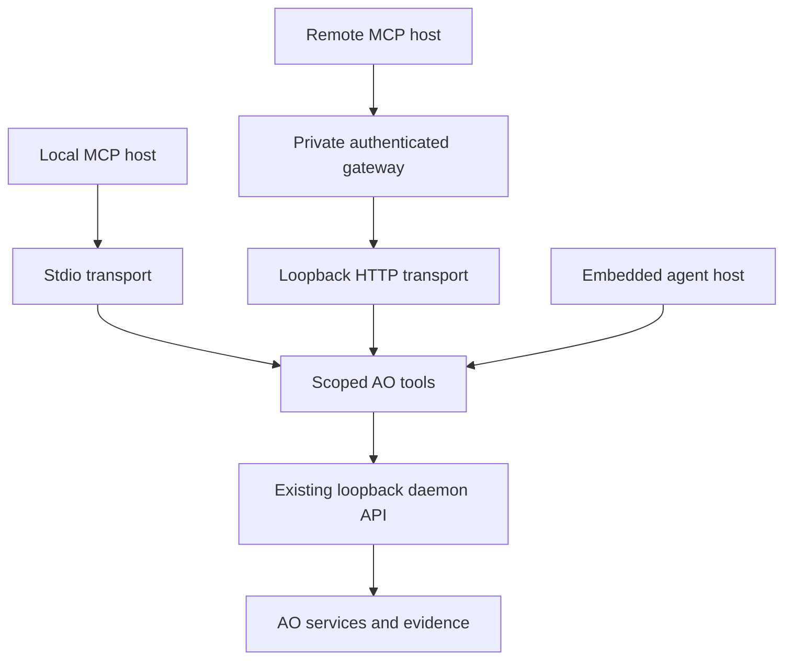

# AO MCP implementation and acceptance plan

## Goal and approved scope

Let external and embedded AI agents operate AO, inspect real work and controller
evidence, and repair code in authorized AO workspaces through a provider-neutral
tool boundary. The first implementation reuses AO's daemon services. It
does not change how AO selects models or providers.

This plan follows the user's requested delivery chain: record the requirements,
implement and test, run the applicable checks, obtain independent reviews,
triage and correct findings, run delta reviews, create a PR, request GitHub Codex
review, and incorporate applicable findings on the current PR head. Merging is
a separate human action.

The scope includes normal operation and debugging. A successful status probe is
only a connection test. It does not prove the Instructor-to-orchestrator-to-agent
chain, the original `ROUTE_NOT_FOUND` problem, or real provider execution.

## Architecture

The standalone package is `packages/ao-mcp`. Its core tool functions can be
called by an embedded host, but this change does not add a chat UI or integrate
an embedded model provider. All tool effects pass through the loopback daemon
HTTP API. Five explicit workspace routes add atomic work/project/incarnation
fencing around existing workspace services, with regenerated OpenAPI and
frontend types. Check admission also validates the actual request deadline.
The adapter has no direct SQLite access; no migration or daemon listener change
is introduced.

Stdio is the default transport. Optional HTTP binds only to `127.0.0.1` and
requires a bearer credential. It is a private gateway bootstrap boundary, not a
public OAuth authorization server. An external gateway or private tunnel must
supply the transport and authentication expected by each remote host.

## Requirements and acceptance

The IDs below describe required behavior, not a declaration that final-head
validation or deployment acceptance has passed. The PR records executable test
results and remaining gaps against its exact head.

| ID | Requirement | Acceptance evidence |
| --- | --- | --- |
| MCP-01 | Reuse AO daemon/service authority rather than implementing a second orchestration engine. | Tests assert the existing HTTP routes and request bodies; no direct storage/runtime access. |
| MCP-02 | Preserve the daemon's primary loopback listener and existing authentication assumptions. | No daemon listener or auth changes; adapter daemon URL is restricted to an explicit loopback origin and rejects redirects. |
| MCP-03 | Support local MCP clients through stdio and private gateway clients through authenticated loopback HTTP. | SDK client transport tests, rejected missing/wrong bearer credentials, and rejected non-loopback listener configuration. |
| MCP-04 | Fix principal, access profile, project IDs and optional native session identity in trusted startup configuration. | Tool arguments cannot supply or change these fields; unknown configuration and malformed identifiers fail. |
| MCP-05 | Offer observer, operator and developer profiles with increasing permissions. | Tool inventory and execution tests reject capabilities below the configured profile. |
| MCP-06 | Keep project, work and session access within the configured scope. | Cross-project reads/writes and unrelated sessions are refused before the requested effect; status returns a scoped projection. |
| MCP-07 | Allow routine work creation, continuation, pause and cancellation. | Daemon-backed request/response tests preserve work IDs and existing command semantics. |
| MCP-08 | Preserve lifecycle command snapshot and idempotency fences, and the existing manual-intake identity. | Lifecycle commands require exact work, snapshot and stable key; stale/error results propagate. Manual creation deduplicates by project/source/sourceRef. No automatic mutation retry or key replacement. |
| MCP-09 | Keep protected human decisions outside agent authority. | No approval, policy override, exception, publication, merge or arbitrary API-call tool; unsupported command actions and approval injection fail. |
| MCP-10 | Expose real work history, delivery/member/controller facts and actionable daemon failures. | Trace tests preserve the factual evidence and error code/request ID; queue admission is never labelled completion. |
| MCP-11 | Read and edit authorized session source through incarnation-scoped workspace APIs. | Current member proof and daemon lifecycle lease fence immutable instance/work/project through I/O; reused display IDs and old unfenced routes fail closed. Tree/search/read/diff and exact expected-file-fingerprint forwarding are tested. |
| MCP-12 | Discover and run existing approved check profiles and expose bounded job results. | Discovery returns names/timeouts without argv, marks profiles exceeding the 45-second adapter budget unavailable; daemon admission reserves the actual deadline plus cleanup. Tests cover effects before HTTP errors, uncertain locks and polling without replay. |
| MCP-13 | Share the same tool implementation across transports and a possible embedded host. | Both transport tests use the common tool definitions; exported core is independent of model-provider selection. |
| MCP-14 | Bound input, daemon response size, execution time and retained job output. | Limit/timeout tests fail explicitly; truncation is visible; errors do not turn unknown effects into safe retry claims. |
| MCP-15 | Document trust and deployment limits accurately. | Stdio and developer execution are described as host trusted; HTTP bearer bootstrap is distinguished from OAuth; no claim of automatic cloud access. |
| MCP-16 | Demonstrate provider-neutral protocol behavior with independent clients. | Modern SDK HTTP, independent legacy JSON-RPC and SDK stdio clients exercise the same server contract; these are protocol tests, not real vendor acceptance. |
| MCP-17 | Validate a real Windows daemon through two selected vendor clients. | Pending live acceptance: actual authenticated ChatGPT and Copilot tool calls against the intended Windows installation. |
| MCP-18 | Reproduce and verify the original AO application problem. | Pending live acceptance: failing API request, installed build identity, correlated work/controller evidence, corrected build and repeated real work flow. |
| MCP-19 | Preserve review independence and final-head evidence. | Independent review findings, dispositions, corrections, delta reviews and GitHub Codex results are visible on the PR with exact SHAs. |

## Implementation sequence

1. **Record boundaries and scope.** Add this plan, the operator guide and package
   quickstart. Make supported operations and deployment gaps explicit.
2. **Build the common adapter.** Add typed startup access configuration, bounded
   loopback daemon client, role/project guards, common tool definitions and error
   mapping. Use the official MCP SDK rather than a second wire implementation.
3. **Add normal operation and diagnostics.** Expose runtime facts, scoped work
   status, traces, creation and safe lifecycle commands. Require explicit work
   scope for mutations and preserve the daemon's receipts.
4. **Add development and verification.** Wrap the existing session workspace
   APIs and approved check profiles. Keep source concurrency checks and return
   job identifiers for check execution.
5. **Connect transports.** Start with stdio, then optional authenticated
   loopback HTTP. Reject network-facing bind configuration. Test modern SDK HTTP,
   an independent legacy JSON-RPC client and SDK stdio.
6. **Validate and review.** Run focused boundary tests, the package suite and
   applicable repository checks. Freeze the reviewed head, independently review
   it, triage findings, correct them and obtain delta review.
7. **Publish reviewable work.** Create the PR, verify its description and remote
   checks, request GitHub Codex review, inspect review comments/findings and
   correct applicable findings through the same checks and review chain. Do not
   merge automatically.
8. **Perform live deployment acceptance.** Configure the Windows adapter and
   chosen clients, verify actual local identity and work receipts, reproduce the
   AO error, and inspect the corrected runtime. Retain the exact build and
   client evidence. This cannot be replaced by scripted protocol fixtures.

## Review focus and initial dispositions

Independent plan assessment identified the following risks. The implementation
must include their stated dispositions, and subsequent code review must verify
them rather than inheriting approval from this table.

| Finding | Disposition |
| --- | --- |
| Generic command forwarding could manufacture human approvals. | Expose only specific safe actions; exclude approval fields and protected actions. No arbitrary HTTP proxy. |
| Portfolio status, inventory or histories could reveal unrelated projects. | Return project-scoped projections; validate work/session ownership on every related request. |
| Stdio support could be mistaken for automatic access from this cloud chat. | Document the separate gateway, client configuration and actual connection proof. |
| Fixed test commands could be mistaken for OS containment. | Explain that approved profiles execute repository code and remain host trusted. |
| A new filesystem implementation could bypass existing containment/concurrency behavior. | Reuse session workspace APIs and require the existing fingerprint on updates. |
| Protocol tests could be mistaken for live ChatGPT/Copilot acceptance. | Keep MCP-16 separate from MCP-17 and MCP-18. |

Reviewers should also inspect authentication before tool execution, malformed
JSON/arguments, credential handling, HTTP host/origin checks, bounded resource
usage, jobs that outlive a request, scope checks for nested payloads, and failure
paths where a daemon effect may already have occurred.

## Validation record and remaining scope

The source implementation provides the following boundaries. This table does
not certify native deployment or the final PR head; exact final test commands,
counts and review evidence belong in that PR.

| Area | Implemented boundary | Verification record |
| --- | --- | --- |
| Operation and diagnosis | Scoped runtime/project/status/trace, manual intake and safe lifecycle tools. | Package fixtures and real isolated daemon smoke; final-head result in PR. |
| Development | Scoped workspace APIs, fingerprint updates, approved profile discovery and bounded check jobs. | Package scope/concurrency/idempotency tests; final-head result in PR. |
| Transports | Stdio and bearer-protected HTTP on `127.0.0.1`. | Modern SDK HTTP, independent legacy JSON-RPC and SDK stdio protocol tests. |
| Embedded reuse | Exported server factory and common tool catalog. | Shared implementation is reused; no embedded model/UI integration is installed. |
| Native CI | Linux and Windows package validation in `.github/workflows/mcp.yml`. | Requires the self-hosted registrations below; queued jobs are not passes. |
| Remote gateway | Deployment guide and authenticated local hop. | No external authentication gateway, public endpoint or tunnel is implemented/provisioned. |
| Real vendor/runtime acceptance | Requirements MCP-17 and MCP-18 retained. | Pending actual Windows ChatGPT/Copilot connection and original AO error reproduction. |

The dedicated workflow uses only self-hosted runners: Linux requires
`self-hosted`, `linux`, `x64`, `ao-ci`, `ci-heavy`; Windows requires `self-hosted`,
`windows`, `x64`, `ao-ci`. These match the dedicated registration convention in
the separate runner migration. Missing capacity leaves checks queued; the
workflow has no GitHub-hosted fallback. A local Linux package pass does not
certify the Windows job.

The PR is the final-head validation record. It must list the exact commands,
results, reviewed SHAs and any unavailable native platform or integration check.
An earlier green head does not certify a correction. Follow
[AGENTS.md](../AGENTS.md) and the PR-description skill for required checks and
verified change counts.

This implementation deliberately reuses existing operation boundaries. It does
not add arbitrary operating-system commands, unrestricted filesystem access,
new-file creation, window clicking, automatic model selection, a public OAuth
gateway, or an installed Windows connection. New files can be created by a
governed worker with existing AO permissions. UI rendering and click failures
still require Computer Use or UI tests. A corrected production daemon installation
is a separate deployment action.

See [AO MCP usage and deployment](ao-mcp.md) for the supported tools and concrete
startup instructions.
