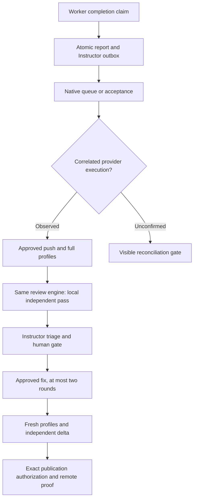

# Instructor runtime handoff and mechanical phases

Managed `ao report --done` reports use the Instructor outbox while
`AO_INSTRUCTOR` is enabled. Report persistence and the required project
orchestrator directive commit in one SQLite transaction. Unassigned reports
retain AO's ordinary batching and settlement deadlines. Generic delivery and
the optional supervision callback do not send a second managed completion.

Each managed result records the report, work, pinned policy, business phase and
phase sequence, producer session and runtime, and the selected target session
incarnation and native runtime. A reused display session ID cannot inherit the
directive or its native receipt. Human decisions remain snapshot-bound.

Producer admission captures membership and the immutable inserted-row key in
one SQL snapshot, then fences that tuple inside the writer transaction that
commits progress, evidence, heartbeat or a dispatch acknowledgment. An unchanged
work revision cannot authorize a recreated session. Native checks use the
captured registered workspace and hold AO's session operation lease through the
profiles; incarnation, runtime, configuration and resource fingerprints are
rechecked before execution and at evidence commit. Changed producers create
visible uncertainty instead of green proof attributed to their replacement.

Stopp uses native interrupt control for the work's current admitted producers,
not another model turn. Exhausted turn budgets therefore cannot prevent a pause.
Historical/reused session IDs and the shared project orchestrator are
excluded. Every current admitted producer is attempted even if an earlier
interrupt or membership read fails; the collected failures remain visible on
the parked work. A cancelled result stays in the audit history but cannot
request checks or retain a wake-up obligation after Weiter or a restart.

Queueing, delivery, native acceptance, agent acceptance/progress and native
execution are separate facts. A native send reply does not fabricate
`nativeReceipt.startedAt`. For eager Chat protocols, a real provider
`turn.started` event supplies execution proof. ACP's locally prepared
`turn.started` is excluded; actual provider content/activity or successful
completion supplies that proof. Receipt, provider-event archive and report
acknowledgment share the same fenced projection transaction. Replay does not
create another receipt or directive. Provider-origin IDs, the enqueue controller generation and the current
observer generation remain inspectable. The recorded started timestamp is when
AO first observed that native proof; replay cannot establish an earlier exact
provider start time or infer which replacement controller originally started it.

A certified failure before native submission receives up to three durable
attempts with five-second deferral. AO-owned Chat FIFO entries use the same
client key across restart. A replacement controller may promote a proved
unsubmitted queue entry; a changed runtime after possible native submission
requires reconciliation. Unconfirmed native execution escalates after 120
seconds without silently sending again. A late genuine receipt can settle that
delivery while preserving other uncertainties and suspended business gates.
Heartbeat and receipt alone do not reset meaningful business progress.

The current TUI hook contract proves correlated prompt submission, not a native
turn start. Its started receipt therefore stays unknown and reaches the visible
reconciliation path; AO does not claim a TUI execution guarantee from a paste,
an agent report or a generic runtime `active` flag. Use a supported native Chat
orchestrator for the end-to-end execution receipt. An installed build, enabled
process flags and live provider capability still need the deployment pilot.

Approved profile argv and local review launches are driven asynchronously by
the same Instructor phase engine. Mechanical actions persist their intent
before native I/O and do not block status or operator commands. A restart with
an unknown unfinished effect blocks visibly rather than creating a second
execution. Terminal profile errors require a fresh snapshot-bound retry gate.
The previous mechanical action must complete or recover its committed native
proof before a new phase directive is frozen. A new action waits until pending
directives for its work have been delivered, preserving their revision fence
and ordered approval cohort. A completed push/full proof for the same producer,
phase and SHA can settle a missing completion audit after restart without
executing those profiles again; an unknown effect still blocks visibly.
Terminal action metadata preserves only a still-current directive in the same
writer transaction when business facts are unchanged. Receipts from a profile
already running when Stop was committed preserve the restrictive pause only;
new check evidence cannot refresh a Go/Weiter snapshot. Native interrupt runs
outside the work mutation lock so profile commits can release their producer
lease. A certified rejection before provider submission cancels the result's
wake-up obligation, retaining its history without fabricating acknowledgment.
Unknown effects require reconciliation even when their error text resembles a
rejection, and a newer operator intent fences an older Stop.
Workers and project orchestrators retain implementation, triage and fix
responsibility; Instructor does not create a second worker orchestration loop.

The clean committed HEAD produced during an already authorized implementation
or fix phase can be observed by the daemon before checks; an agent's separate
SHA message is not required to unstick a fix. Other phases reject a conflicting
HEAD. Verified profiles and reviews remain bound to that exact commit, pinned
policy, producer incarnation and business phase. Review uses AO's existing
review engine with an empty PR reference for local work, never a synthetic PR
or remote posting. A distinct delta scope creates an independent pass even at
the same SHA; the prompt limits that pass to the resolved findings and changes
that may have introduced regressions.

## Legacy policy decision

The former `reportsync`, `reactionloop` and `triagegate` packages had no
production execution callers. Their only dependencies were mutual types and
tests, so the inactive cluster was removed instead of introducing another
business state machine or a second tracker-write path. The old flags remain
observable as unsupported/deprecated requests in process readback.

| Former responsibility | Current runtime owner |
| --- | --- |
| Work/report validation and attributed facts | Instructor report admission, incarnation-safe membership and atomic result outbox |
| Phase progression and human triage | Instructor engine, exact phase evidence and snapshot-bound transition gates |
| Review/fix/delta ordering | Existing review engine with work/phase scopes and Instructor fix-round enforcement |
| CI success and closed findings | Trusted Instructor evidence assessment for the exact SHA and native review provenance |
| Issue/project board proof | Current traceability contract and trusted evidence; no old FAKTEN writer runs |
| Publication red lines | Exact publication grant and the separately verified execution capability boundary |
| Poll/session budgets | Persistent managed budget boundary, not old callerless counters |

Focused regression tests cover atomic handoff, generic-delivery exclusion,
restart recovery, bounded pre-submission retries, missing start escalation,
unrelated provider events, rollback of archive/receipt/acknowledgment, late
receipt reconciliation, real profile execution, one mechanical local review,
uncertain-action recovery, new fix HEAD and distinct same-SHA delta scopes.
They do not substitute for authenticated native inference or the deployment
pilot on the operator's machine.
