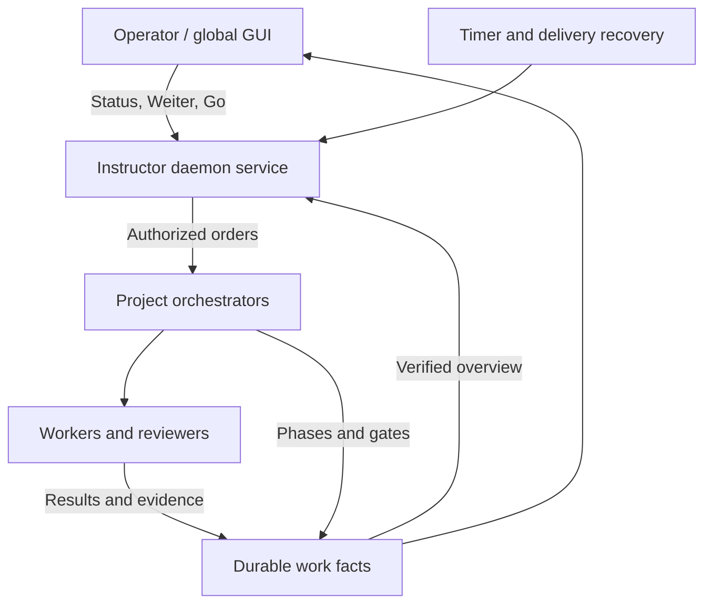
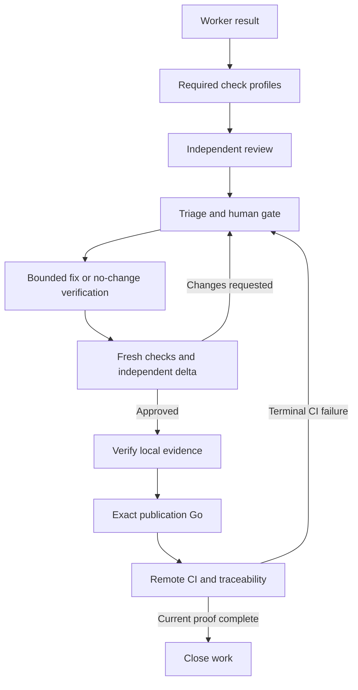

# Instructor control plane

The Instructor is the portfolio-wide operating view above project orchestrators.
It gives the operator short status and decision commands while project
orchestrators execute their own worker/reviewer chains. Registration, dispatch,
evidence and gate enforcement belong in the daemon; the GUI and chat consume
the same work facts.

The [consolidated Rulebook](artifaktory/instructor/RULEBOOK.md) states the approved
behavior. [Acceptance coverage](instructor-acceptance.md) distinguishes that
contract from implementation and verification. A documented rule is not by
itself an enforced runtime feature.

The [repository policy example](artifaktory/instructor/POLICY.md) describes the
structured fields and a Markdown-embedded contract. Adapt its native model
values and required profiles to the repository before activation.

In **Policy settings**, an unconfigured check command (`null` or `[]`) appears
as an empty field. Enter the executable and each argument on separate lines;
clearing the field leaves the profile unconfigured. Opening or closing the
dialog does not save a policy. Saving an untouched profile retains its command
value and timeout. Required checks still need configured commands before they
can execute.

## Responsibilities

| Role | Responsibility |
| --- | --- |
| Operator | Goals, priority, human authorization and budget changes |
| Instructor | Clarify intake, coordinate projects, summarize verified state and route decisions |
| Project orchestrator | Plan work, manage task/review chains, request missing evidence and escalate |
| Worker / reviewer | Perform the assigned operation and produce revision-bound evidence |
| Daemon | Durable identity, policy checks, dispatch, recovery, timers and audit |



Long-running planning and execution are asynchronous. Status reads the current
verified projection, and commands are durable requests. The Instructor remains
available while a project is executing. A queued request, successful delivery
and verified progress are different facts.

## Work rather than sessions

One work ID survives from intake to closeout. Its sessions, automation runs,
issues, pull requests, branches, worktrees, checks and reviews are associated
resources. The main table represents works; an inventory view exposes resources
that still need association.

Existing automation scheduling and form configuration keep their existing
workflow. Each run is registered and linked to work. Manual starts use the same
managed enforcement boundary. Outside-AO work can be discovered/imported, but
is marked unverified until its evidence is independently established.

## Short commands with explicit authority

The initial command vocabulary includes Status, Tore, Weiter, Go, Stopp,
Details, Prüfen and Neu, with individual-work and eligible batch scopes. The
registry supplies the same typed parameters and predicates to chat and GUI
forms. Documents can add commands by composing known operations; new technical
capabilities require adapters.

Go and Weiter refer to an immutable status snapshot. The daemon rechecks the
selected work revision and gate. An ordinary Go cannot substitute for the exact
human publication authorization `PUBLISH-GO [Branch]`. Batch failure stops the
remaining items and retains the audit of completed items.

Ordinary decisions use AO's existing local operator API. Publication requires
an enforced isolated worker runtime, protected operator authorization and
publisher credentials unavailable to workers. A `PUBLISH-GO [Branch]` phrase,
CORS origin, role header or environment flag alone establishes none of these.
The current tmux/conpty and native Chat hosts share the operator's OS user, so
the production daemon reports publication unavailable and refuses to mint a
publication grant or execute a managed publication. Ordinary gates and
resumption remain available. This does **not** prevent a separate process from
running `git`/`gh` using the same user's credentials; full host containment needs
an actual isolated runtime and protected operator/publisher adapter.

The controlled publication endpoint binds its single-use grant to work,
commit, branch, policy, captured snapshot, operator proof and operation. It
persists a revision-guarded claim before any external effect. A replay is
refused, and a failed/interrupted attempt remains consumed until independently
reconciled. AO's ordinary host-credential merge endpoint refuses governed PRs,
including a known governed repository branch reassigned to another session;
unmanaged PR behavior remains unchanged. Historical grants remain historical
evidence records and cannot acquire protected execution authority retroactively.
The native strategic planner cannot approve publication; applying its advice
still goes through ordinary operator admission.

## Enforceable governance

Guidance documents describe behavior. A structured repository policy declares
roles, model profiles, required check profiles, review stages, evidence,
budgets and approval requirements. The daemon applies that policy at managed
starts, delegation, resumption, transitions and closeout.



Evidence belongs to the current commit and governance revision. Completing a
session or uploading a claim that checks passed is insufficient. Repository
integration must supply verified check results and review provenance.
A clean initial review still passes the explicit no-change verification and
fresh delta stages. A trusted terminal CI failure after publication returns to
the same human-approved correction loop and consumes the remaining fix budget.
A corrected commit needs fresh checks/delta and its own exact publication Go;
an earlier SHA's approval cannot authorize the new one.

Status does not repeatedly run the full suite. Changed facts, explicit Prüfen
and scheduled audits drive deeper verification. Availability heartbeats persist
separately from receipt, progress and work revisions. A heartbeat cannot change
phase/evidence or reset the no-progress nudge. Background inventory continues
without an open GUI. The acceptance matrix records final-verification coverage;
a generic work update does not prove worker liveness.
Before execution, phase advancement, approval and closeout, the daemon checks
the current native-source fingerprint against a completed inspection. Changed
sources wait for bounded reinspection; vanished or invalid retained native
proof is revoked instead of remaining green.

## Execution budgets

Work execution also has optional persisted [session/delegation/turn budgets](instructor-budgets.md).
Concurrent capacity and lifetime consumption are separate; unknown native effects
retain their reservations across daemon restarts. These caps apply to AO-owned
native execution routes, not unobserved provider-internal subagents or raw terminal
keystrokes. Legacy pinned policies remain unchanged.

## Native model effort

Roles configure harness/provider/model plus the selected model's native effort
or variant. A shared numeric budget or universal `max` is not a substitute for
the model's supported values. The same choice must reach manual starts,
automation, child sessions, resume and restoration.

The UI distinguishes **configured**, **passed to tool**, and **confirmed by
tool**. Where a provider cannot confirm a setting, confirmation remains unknown.
An unsupported mandatory setting fails visibly instead of silently selecting a
lower effort. Native ACP also refuses a requested read-only reviewer/planner
sandbox when the provider cannot enforce one, before launching or adopting that
provider. OpenCode ACP currently lacks that enforceable read-only capability,
so selecting it for native strategic planning is visibly refused before a turn.
Native effort is separate from check/planning timeouts, stall windows,
fix rounds and verification limits. Optional token/cost caps are outside this
change and are not enforced or implied by an effort choice.

The legacy opt-in `AO_OPENCODE_EFFORT_FLOOR` resolves an omitted model from
OpenCode's effective `debug config` in the same project/environment, then pins
that model before validating its native variants. It uses `max` only when the
selected model advertises it. The models command does not expose a default
variant, and the config command does not expose implicit recent/fallback model
selection. If the configured default cannot be resolved, select an explicit AO
model; explicit native choices remain available when config discovery is
unsupported. Discovery does not request a server or inference, though native
CLI initialization can initialize configuration or plugin dependencies.

## Implemented operator interfaces

The global Instructor page is available above projects in the sidebar. It reads
real daemon work, inventory, events, gates, verification and native configuration
facts. Displayed snapshots stay frozen during a decision. Refresh or Status
captures a new snapshot; delta display retains its base decision scope.

The CLI calls the same HTTP daemon boundary:

```sh
ao instructor capabilities
ao instructor inventory
ao instructor status --json
ao instructor details work-ID
ao instructor command weiter --snapshot SNAPSHOT --work work-ID --key operator-1
ao instructor command go --snapshot SNAPSHOT --work work-ID --key operator-2 --approval 'PUBLISH-GO branch-name'
```

The exact publication phrase is supplied only when the displayed work has that
publication gate. It is never filled in by a generic Go-all command. Name-based
selectors and aliases resolve inside the captured work cohort; ambiguous names
return available choices.

`register --input FILE`, `attach work-ID --session SESSION`,
`report --input FILE`, `checks work-ID --session SESSION --profile push,full`,
`verify work-ID --input EVIDENCE`, and `policy --input FILE` expose intake, association, reports,
native checks, inspection and global policy configuration. Structured repository
policies remain the source for project-specific behavior. `reconcile --snapshot
SNAPSHOT --work work-ID --dispatch DISPATCH --accepted=true --note OBSERVATION`
requires an explicit observation of one uncertain dispatch; it does not
approve a suspended publication gate.

`plan --request TEXT --snapshot SNAPSHOT --key REQUEST-ID` queues a global
strategic request; `plans` and `plan-status PLAN-ID` read its durable history
without waiting for inference. The page offers the same request/history view.
The native Instructor runs in an isolated read-only conversation over the
frozen snapshot and registered project names. It requires an actual empty
external MCP/connector inventory before sending a turn. Unsupported isolation
fails visibly. Its output contains questions, typed command proposals and
intake drafts; it cannot approve or execute them. Applying a proposal uses the
existing snapshot-bound command path and keeps publication phrases human-entered.
An interrupted native request is not silently repeated after restart.

`exception preview|apply --input FILE` supports scoped human exceptions. Preview
returns the proposal hash and exact `EXCEPTION-GO work-ID HASH` phrase. Apply
requires the same snapshot, work, concrete selection or fix budget, reason and
expiry within 24 hours. It creates a new pinned policy revision for that work;
earlier proof cannot count as current-policy evidence. Expired grants block
further governed execution. Global and repository policy cannot embed a work
exception or raise the locked baseline fix budget themselves. Once any valid
publication grant has been recorded, that work's policy cannot be rebound by
an exception; a later policy change requires a follow-up work.

Git inventory is read-only and bounded to registered project/session roots and
their worktrees. Unknown paths, cancellation and scan limits appear as incomplete
observations. The daemon captures them immediately and every 60 seconds while
enabled. Status reads cached facts; disappeared resources retain first/last-seen
timestamps until explicit fenced metadata reconciliation. Reconciliation does
not delete Git resources, and rediscovery reopens them. External unassigned
resources remain unverified. SCM/attribution
inspection reads actual provider and immutable Git facts; workers/orchestrators
must create required issue comments and board updates using their configured
integration. The daemon verifies the resulting artifacts before closeout.

## Activation and compatibility

The integration is opt-in through `AO_INSTRUCTOR` so existing daemon behavior
can remain available while a project is migrated. API capabilities and effective
policy report whether the feature is active. Without the flag, mutations return
an explicit unavailable capability and inventory remains readable. Managed
launches need an explicit native model/effort and an approved exact-model mapping
for the baseline `maximum` intent; adapt the example before enabling execution.
See the implementation matrix for
the exact runtime entry points and verified behavior before using it to govern
existing production work.

Local work data remains under the existing AO data directory. Changes must use
new non-destructive storage migrations and preserve existing automation and
session APIs. Build and install the fork through the existing
[desktop build instructions](artifaktory/10-bauen-und-installieren.md); pushing
the fork does not transfer another machine's local sessions or credentials.

## Carry policy settings to another machine

The GUI saves the global policy in local SQLite. To version the actual selected
roles, native effort mappings and profiles, export a plain policy file in the
fork. `ao instructor policy` prints the policy object directly, without a
`data` wrapper. Remove its local optimistic-concurrency `version` before a
deliberate import on another machine; the daemon recomputes the content hash.
In a POSIX shell with `jq`, from the fork root:

```sh
mkdir -p governance
ao instructor policy | jq 'del(.version)' > governance/instructor.json
```

The equivalent PowerShell export preserves the nested fields and writes UTF-8
without a BOM:

```powershell
$policy = (ao instructor policy) | ConvertFrom-Json
if ($LASTEXITCODE -ne 0) { throw 'Policy export failed' }
$policy.PSObject.Properties.Remove('version')
New-Item -ItemType Directory -Force governance | Out-Null
[IO.File]::WriteAllText(
  (Join-Path (Get-Location) 'governance/instructor.json'),
  ($policy | ConvertTo-Json -Depth 64),
  [Text.UTF8Encoding]::new($false))
```

Review that file for machine-specific paths, account identities, allowed fork
destinations and credentials before including it in the fork's normal PR/build
workflow. `governance/` is outside the ignored local `.ao/` state directory.
Provider/tracker authentication remains configured separately on each machine.

On the other machine, check out that fork revision and build/install its desktop
app using the existing guide. Before launching the fork app executable from
that environment, enable Instructor and point to the checked-out policy:

```sh
export AO_INSTRUCTOR=1
export AO_INSTRUCTOR_POLICY="$PWD/governance/instructor.json"
```

```powershell
$env:AO_INSTRUCTOR = '1'
$env:AO_INSTRUCTOR_POLICY = (Resolve-Path governance/instructor.json).Path
```

Fully exit an already-running desktop app before changing its launch
environment; these variables must reach the daemon it owns. Use the built or
installed fork executable from the build guide. `ao start` is the existing
desktop-app resolver, rather than a standalone daemon launcher; it is not a
command for deploying a new fork build.

A stored local global policy takes precedence over `AO_INSTRUCTOR_POLICY`.
To deliberately replace that policy with the tracked settings, after starting
the Instructor-enabled daemon run:

```sh
ao instructor policy --input governance/instructor.json
ao instructor policy
```

The second command confirms the effective policy and its recomputed version.
The import affects future work; existing work keeps its pinned policy. No
settings sync service, runtime-state transfer or credential export is implied.

## Work members and runtime identity

`GET /api/v1/instructor/works/{workId}/members` is an on-demand daemon projection
for the Instructor board. It groups associated agents and retained review passes
under the stable work, with a separate logical project coordinator key
`projectId:orchestrator`. The current project orchestrator is a runtime observation;
reading it neither adopts it into a work nor rewrites a dispatch's historical target.

Session display IDs can be reused after deletion. Each inserted session row now
receives a database-owned immutable instance ID, independent of controller launch
and restore generations. Explicit admission records that instance atomically with
the work revision and a durable membership history entry. Ordinary work updates
never reconstruct bindings from the append-only `sessionIds` history. Deleted
membership remains historical and has no link into a replacement agent using the
same display ID. Dispatch admission and producer reports also check the captured
instance instead of granting authority from that historical display ID.

Migration 0195 captures existing live binding rows as `legacy_bound`; it cannot
prove that an old assignment was originally correct. The board exposes these as
`legacy_unknown`, without an open target, until explicit same-work attachment
confirms the current association. Existing governance authority remains enforced
for the captured live binding. Historical IDs lacking a binding remain unknown;
they are never automatically joined to a currently reused ID. This upgrade does
not fabricate missing worker launch or provider confirmation evidence.

The projection includes the captured work revision and completion timestamp and
reports `atomic: false`: the work and runtime portfolio are not a global database
snapshot. Each session's row and inserted identity are read together; an observed
concurrent work revision change returns a conflict for retry. Current and retained
historical navigation targets name existing AO session/review surfaces only.
Requested, sent and confirmed native configuration stay distinct. Confirmation
from an earlier controller generation cannot confirm a restored controller.
